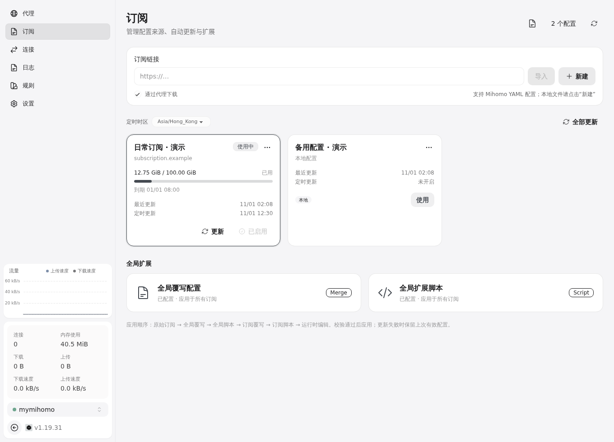
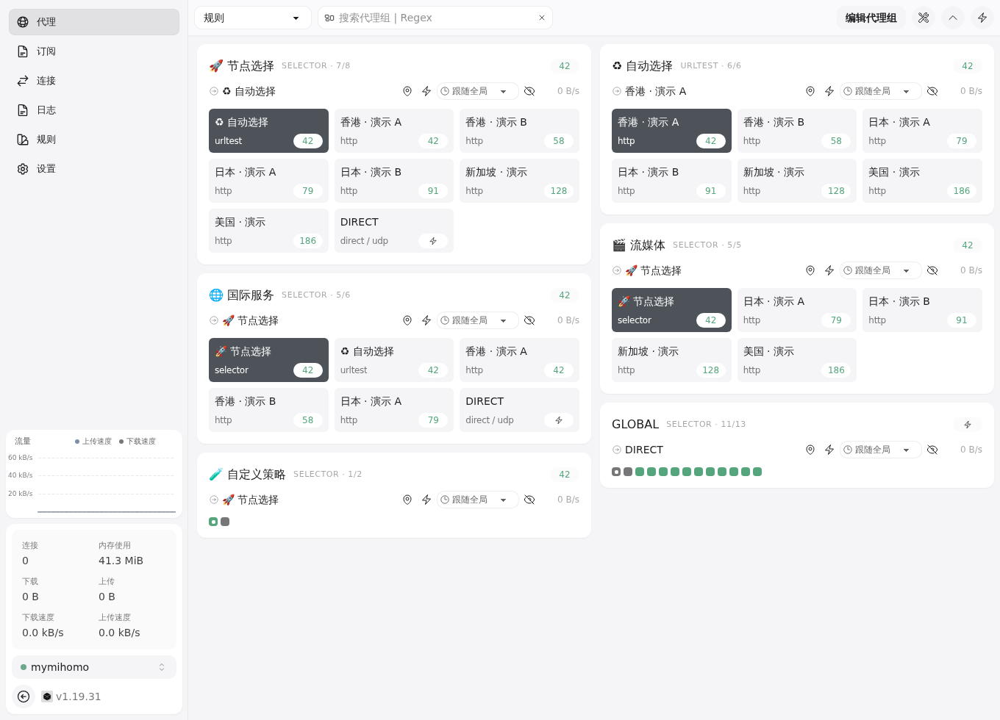
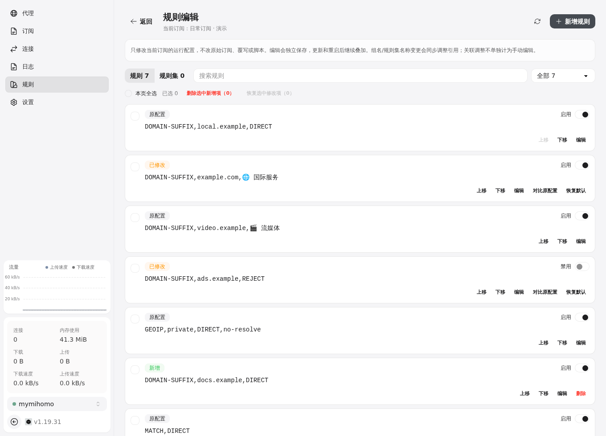
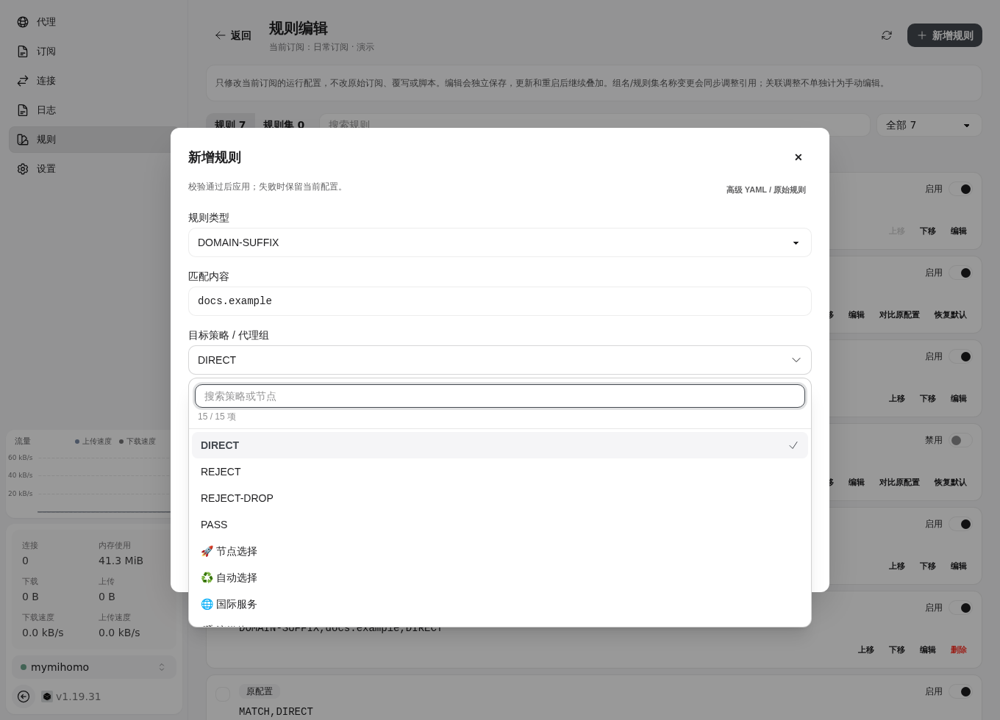

# mymihomo

**在浏览器里管理服务器上的 Mihomo 代理、订阅和运行配置。**

mymihomo 将 Mihomo 内核、zashboard 面板与配置管理服务放在同一个 Docker 部署中，适合 Linux 服务器、家庭服务器和局域网设备。无需桌面环境，电脑和手机都可以完成订阅更新、代理切换、规则编辑与访问密码管理。

本项目在以下两个开源项目基础上改造并整合：

1. **[wenfer/mymihomo](https://github.com/wenfer/mymihomo)**：本仓库的 fork 来源，提供 Docker 部署、订阅下载和配置处理的后端基础。
2. **[Zephyruso/zashboard](https://github.com/Zephyruso/zashboard)**：Web 面板基础。本仓库维护其 v3.30.0 源码，并加入订阅管理、运行时编辑和访问管理等功能。

代理内核继续使用 [MetaCubeX/mihomo](https://github.com/MetaCubeX/mihomo)。后端与定制前端在本仓库共同维护，默认主分支为 `master`，开发分支为 `dev`。

## 能做什么

- **订阅管理**：导入链接或本地 YAML，管理多份配置，手动/定时更新，支持直连或代理下载。
- **配置扩展**：全局与单订阅 YAML 覆写、JavaScript 脚本；应用前进行内核校验。
- **代理管理**：选择节点、测速、延迟排序、定位当前节点；新增或编辑手动/自动选择代理组。
- **规则管理**：编辑规则与规则集、启用/禁用、调整匹配顺序，从完整策略列表中选择目标。
- **保留自己的改动**：运行时编辑按订阅独立保存，更新和重启后继续叠加；支持变更筛选、对比、恢复默认及批量删除新增项。
- **访问管理**：统一登录入口，在设置页修改密码和退出登录，电脑和手机共用一套界面。

## 界面预览

以下截图来自独立演示环境，订阅、节点和流量数据均为示例。

### 订阅与全局扩展



### 代理组与节点



### 运行时编辑与变更管理



### 完整策略选择



## 快速开始

需要 Docker 和 Docker Compose。首次使用从源码构建镜像：

```sh
git clone https://github.com/dqgod/mymihomo.git
cd mymihomo
git switch dev
cp .env.example .env
```

编辑 `.env`，设置服务器的 `MYMIHOMO_LAN_IP`、初始访问密码 `WEB_CONFIG_SECRET` 和内核密钥 `EXTERNAL_SECRET`。没有已有下载代理时，将 `HTTP_PROXY` / `HTTPS_PROXY` 留空，导入订阅时取消“通过代理下载”。

```sh
docker build -t local/dqgod-mymihomo:dev .
docker compose -f compose.local.yaml up -d
```

打开 `http://<服务器局域网IP>:9097` 并登录，在**订阅**页面导入配置，再点击**使用**。有配置之后即可在代理页选择节点，或在规则页调整分流。

| 默认端口 | 用途 |
| --- | --- |
| `7897` | HTTP / SOCKS5 混合代理，供本机和指定局域网地址使用 |
| `9097` | 带登录认证的 zashboard 和管理 API |
| `19097` | 容器内部的 Mihomo 控制接口，不映射到主机 |

旧款 CPU 如需 compatible 内核，请参考 [Linux 部署指南](LOCAL_DEPLOYMENT.md)。

## 配置如何生效

```text
原始订阅
  → 全局覆写与脚本
  → 单订阅覆写与脚本
  → 持久化运行时编辑
  → 部署设置与内核校验
  → 应用到 Mihomo
```

远程订阅原文只读。页面编辑不会回写原始订阅或扩展脚本；只改过的字段才覆盖基准值，其余字段继续跟随订阅更新。上游移除被编辑的项时，会保留最后有效版本并标记，供你检查处理。校验失败时保留原有有效配置。

私有数据保存在 `.env` 和 `conf/`，更新镜像时应保留并备份这些文件。

## 文档与开发

- [配置与使用指南](docs/CONFIGURATION.md)：订阅、覆写、脚本、运行时编辑、密码和 CLI。
- [Linux 部署指南](LOCAL_DEPLOYMENT.md)：端口、兼容内核、更新和私有数据。
- [开发维护约定](AGENTS.md)：目录职责、边界和验证要求。
- [前端上游维护说明](web/zashboard/UPSTREAM.md)：如何合并 zashboard 后续版本。
- [变更日志](CHANGELOG.md)。

后端使用 Go，前端使用 Vue / TypeScript。开发需要 Go 1.23+、Node.js 24 和项目锁定的 pnpm 版本：

```sh
go test ./...
scripts/build-ui.sh
```

## 上游与许可

感谢 mymihomo、zashboard 和 Mihomo 的上游维护者。第三方组件遵循各自许可证；前端保留了 zashboard 的 [MIT 许可证](web/zashboard/LICENSE) 与第三方声明。
